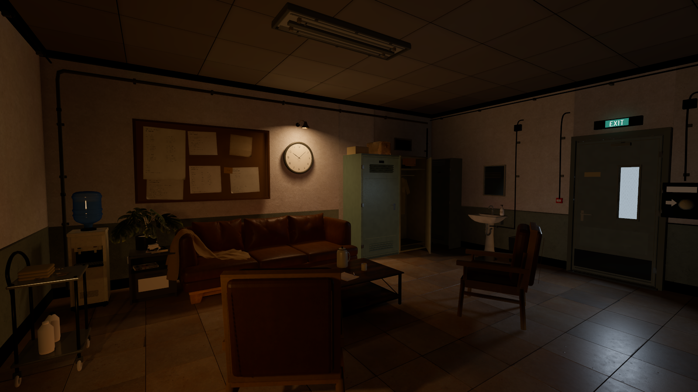

# 第七日 · Godot 等待室

当前可运行版本：**2026-10-30，稍冷的米白色墙面**。

使用 **Godot 4.6 / Forward+** 导入 `godot/project.godot`，等待首次资源导入完成后按 **F5**。无需 Blender 或额外下载贴图。

[当前版本说明与调色位置](docs/当前版本_20261030.md) · [操作说明](godot/README.md) · [早期质感小样](docs/质感小样_交付.md)

本次上传包含当前场景、模型、材质、贴图、字体、烘焙光照和脚本；Godot 缓存、本地备份及历次诊断截图不随本次提交上传。
