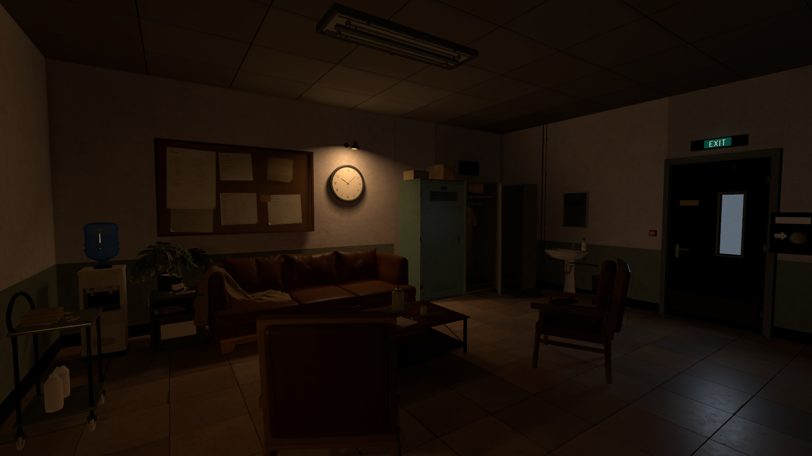

# 第七日 · Godot 等待室

**场景阶段交付：2026-11-01。** 当前版本已由用户确认，本阶段场景调整暂告一段落。

使用 **Godot 4.6 / Forward+** 导入 `godot/project.godot`，完成首次资源导入后按 **F5** 运行。

[本阶段交付与打开方式](docs/场景阶段交付_20261101.md) · [游戏操作及编辑位置](godot/README.md)

工程包含模型、材质、贴图、字体、烘焙光照与游戏脚本。Godot 会在首次打开时生成本机导入缓存。本地备份和制作过程中的诊断截图不包含在本次同步中。
