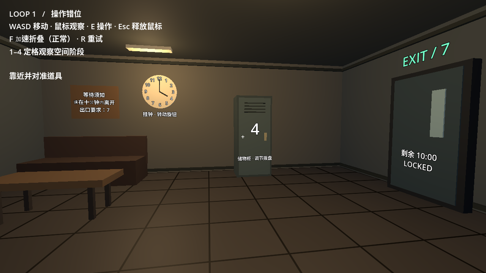
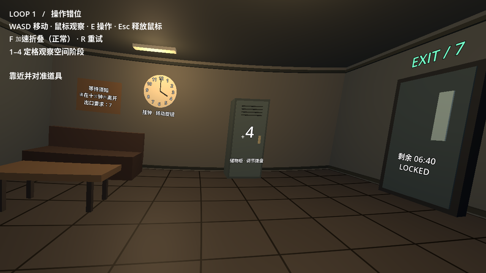
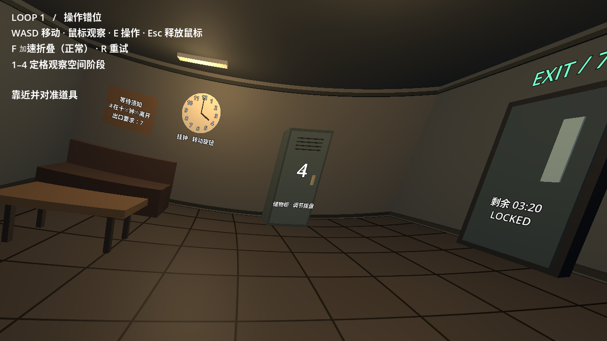
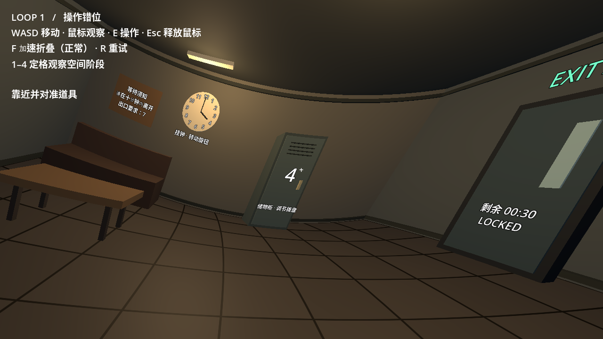

# 错位等待室：最小可玩原型

用 Godot 4.6.3 制作和验证。无需第三方插件、模型或联网服务。

## 试玩

安装 Godot 4.6 或更新的兼容版本，导入本目录的 `project.godot`，按 **F6/F5** 运行。
也可以在此目录执行 `godot --path .`。

- WASD：第一人称移动；鼠标：观察。
- 靠近并对准挂钟、柜子或门，按 E 操作。
- Esc：释放鼠标；点击游戏画面恢复捕获。
- F：切换 60 倍时间，加速观察空间折叠；R：重回 Loop 1。
- 1 / 2 / 3 / 4：定格观察正常、轻微、中度、极限四个阶段（暂停计时）。按 F 恢复计时，R 回到初始状态。
- 门上的显示给出实际剩余时间。正常模式为十分钟。

解谜：操作挂钟改变柜子数字，操作柜子改变挂钟。挂钟到 7 点后，来到出口按 E 离开。
成功显示 CLEAR / RESET 并进入 Loop 2；超时显示空间失控 / RESET，回到 Loop 1。
Loop 2 复用同一谜题，只演示循环，不代表第二关。

## 验证

`godot --headless --path . -- --smoke-test`

自动检查六面房间的边界配对、变形不会翻转或塌陷、严重变形下的瞄准、操作错位、解锁、成功循环与超时重置；失败返回非零退出码。
云环境内需要将 XDG_DATA_HOME、XDG_CONFIG_HOME、XDG_CACHE_HOME 指向可写目录。

## 当前边界

这是简单几何体原型。房间外壳的六个面使用一致的边界细分和连续空间变形，地板纹理、家具和门框也跟随拉伸。
通过后部压缩、斜向剪切和局部弯曲产生不同区域的透视错位；未实现独立摄像机的多重投影或参考图中的写实材质。
移动采用原始坐标的导航边界与简化家具阻挡，摄像机位置跟随变形，不是正式物理碰撞系统。
出口用 E 触发穿门流程，尚无走过门槛的检测。
中文文本使用系统字体回退；若本机缺少中文字体，请安装中文字体。
工程无第三方素材。正式发行前仍需完成画面、碰撞、可用性、性能和平台测试。

云端已验证功能检查，并使用兼容 OpenGL 渲染实际截取四个阶段，检查了房间连接和拉伸效果。
截图见 `previews` 目录；实际鼠标手感与用户电脑上的表现仍需试玩。未提供独立可执行文件。

## 四阶段实际截图

正常 → 轻微 → 中度 → 极限，均使用同一个位置和视角。

