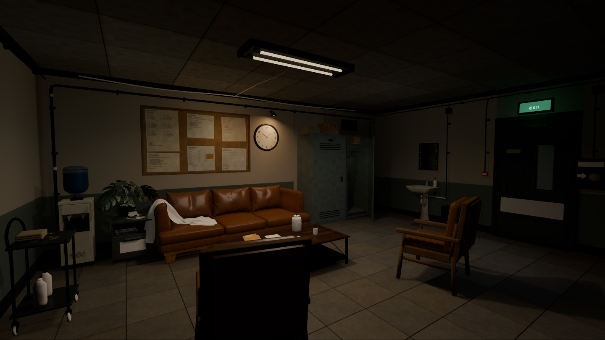
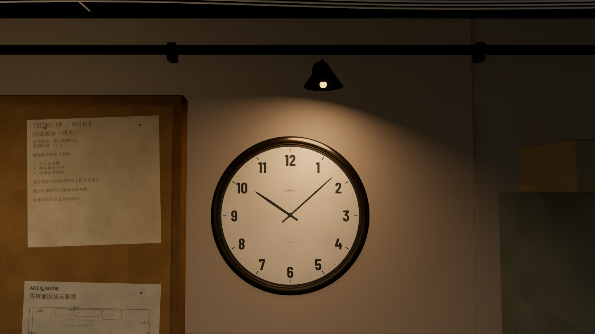
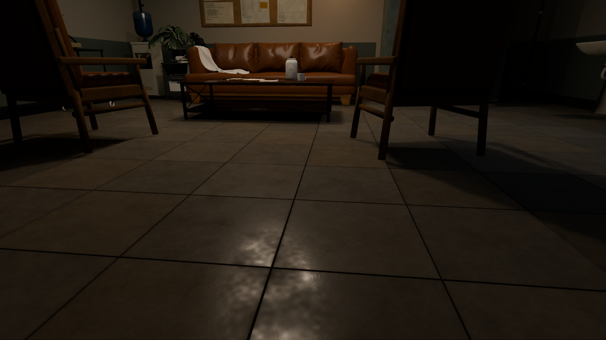
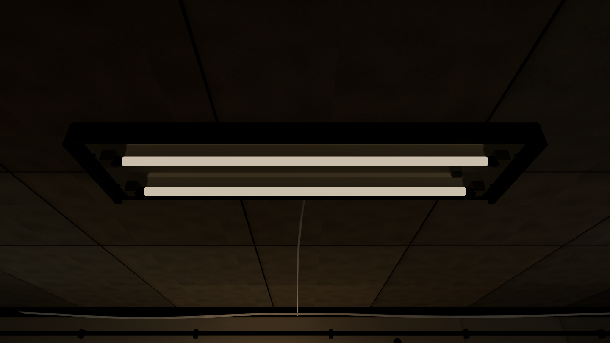
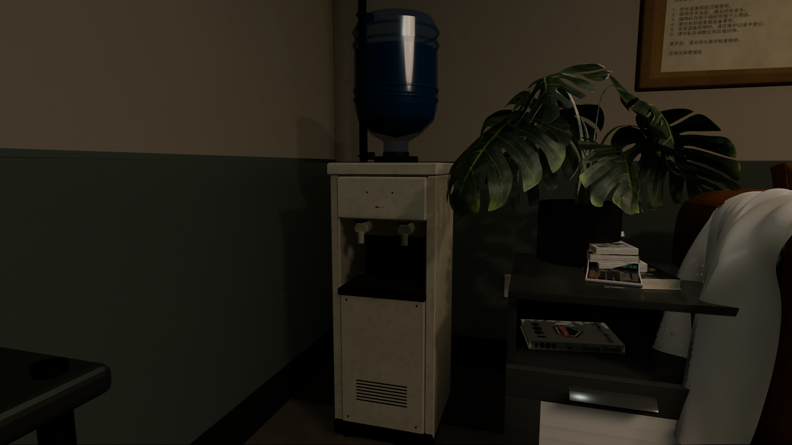
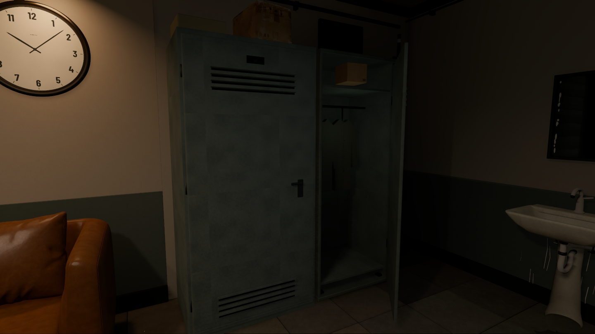

# 等待室 · Godot 整景交付

更新于 2026-10-18。本轮直接在 **Godot 4.6 / Forward+** 修改地板、天花灯、挂钟、饮水机和柜体。没有打开、另存或覆盖 Blender 工程。

## 最新：光影与墙面修订

- 移除墙面和下半墙涂料中重复的大块云状斑纹，替换为细灰泥/漆面纹理；隐藏粗大折线裂缝，压暗原先过亮的顶角条与踢脚线。
- 顶灯从单个集中点光改为沿灯管分布的宽角照明，降低灯管自身的刺眼发光。暖色壁灯突出挂钟和公告区域，出口冷光降低；用少量反射补光保留柜体和洗手区的暗部细节。
- 54 个原有家具网格新增独立光照 UV，沙发外壳、椅子、茶几及边柜真正参与静态阴影和反射光烘焙。保留原模型、纹理与位置；百万顶点的原沙发靠垫继续使用实时光与间接光探针，没有替换成低精度模型。
- 使用高质量、六次反射的 LightmapGI 重烘焙，覆盖 325 个静态表面；主要顶灯和壁灯仍保留实时照明及阴影，使柜门开合和移动物体能响应光线。
- 挂钟靠回墙面并调整壳体深度。固定挂钟的贴墙接触阴影使用平滑程序化近似，关闭其会产生锯齿的实时投影；这项处理不作用于柜门、把手等移动物件，也没有声称是物理精确的挂钟投影。

已从同一机位检查整景、地面、挂钟和双柜；当前截图是 Godot 运行结果，不是离线渲染。

## 打开工程

下载仓库后，在 Godot 中导入 [`godot/project.godot`](../godot/project.godot)，等待首次资源导入完成，再按 F5 运行。

资源导入设置随工程保留；`.godot` 缓存不入库。已经在独立目录验证过首次导入、场景运行和交互，不依赖原来的本地 Blender 导出工程。

## 本轮画面

## 主要变化

- 地砖修复原 BoxMesh 顶面 UV 只占贴图局部导致的模糊问题，改为完整砖面 UV 和真实倒角；重新生成四套细纹理与局部磨损粗糙度。抬高砖缝下层，避免几厘米深的黑槽。
- 挂钟底色明确为米白色，暖色来自壁灯。新增厚侧壳、背壳、滚边、内压圈、浅弧玻璃、中心铆钉和螺钉；数字放大，针体细化。关闭薄钟针的阴影，修复表盘上的锯齿影子；时针、分针保持独立。
- 天花灯替换为完整的旧双管荧光灯结构，停用旧灯壳和灯管，补出灯座、反射罩、端盖与启辉器，降低刺眼发光。小壁灯灯泡也缩小并降低亮度。
- 饮水机补出倒角外壳、双阀与向下出水嘴、接水盘格栅、检修门、脚垫；蓝桶具有独立桶壁、水体和加强筋。水嘴移到开口前方，避免全部陷入阴影。
- 公告板和挂钟向左调整，六张公告与一张便签贴合板面；便签压住维护记录，使用手写 `17:3`，后续仅替换文字。
- 主柜从上版约 0.99 米深收至约 0.67 米，并靠回墙边；宽度约 1.05 米、高度约 2.21 米。相邻新增旧灰绿色金属衣柜，带打开的柜门、挂衣杆、衣物、隔板、百叶和号码牌。调整柜顶纸箱及标签的支撑位置。
- 修复导入阴影代理导致的脱离模型的大块黑影，改为由可见网格投影。修复切换钟针时意外改变小时的界面问题。

## 验证

真实 GPU 实机截图；LightmapGI 重新烘焙，168 块地砖保留独立 UV。交互检查包括收薄后的主柜中，玩家胶囊体实际穿过柜内镜面及出口、柜门开合、把手拿取、龙头损坏与流水、钟针选择、重复房间和便签三状态。模型检查覆盖倒角、砖面完整 UV、砖缝高度、米白表盘底色、新灯具独立构件及旧灯具停用。新增检查确认主要家具参与烘焙、动态阴影光源保留，以及墙面不再含大幅重复云状色差。

完整的编辑位置、操作方式及后续范围见 [工程说明](../godot/README.md)。入口细修、EXIT 最终图形设计、细节做旧和原家具减面尚待后续处理。本轮没有将这些未处理项宣称为完成，也不宣称整景已与参考图完全一致。

本机 Godot 4.6 在退出实机预览时仍报告少量 Texture RID 释放警告；该问题已记录，没有将其标记为已修复。
