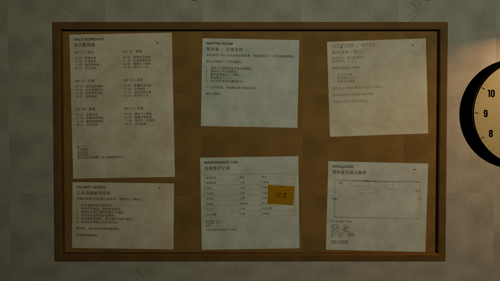

# 等待室 · Godot 整景交付

本轮已直接在 **Godot 4.6 / Forward+** 完成整景修改。没有打开、另存或覆盖 Blender 工程。

## 打开工程

下载仓库后，在 Godot 中导入 [`godot/project.godot`](../godot/project.godot)，等待首次资源导入完成，再按 F5 运行。

资源导入设置随工程保留；`.godot` 缓存不入库。已经在独立目录验证过首次导入、场景运行和交互，不依赖原来的本地 Blender 导出工程。

## 本轮画面

## 主要变化

- 已接受的样板地砖、材质、冷暖灯光应用到完整房间；灯管与灯泡在游戏内可见发光并照亮周围。
- 挂钟改为大号粗体数字和哑光表盘，时针、分针保持独立；小灯改为参考图中的短臂金属壁灯。
- 公告板和挂钟向左调整，六张公告与一张便签贴合板面；便签压住维护记录，使用手写 `17:3`，后续仅替换文字。
- 柜体变浅，缩短前方空闲空间；保留现有主要家具与 Loop 交互。
- 修复导入阴影代理导致的脱离模型的大块黑影，改为由可见网格投影。修复切换钟针时意外改变小时的界面问题。

## 验证

真实 GPU 实机截图；LightmapGI 烘焙包含 247 个静态表面，168 块地砖保留独立 UV。交互检查包括玩家胶囊体实际穿过柜内镜面及出口、柜门开合、把手拿取、龙头损坏与流水、钟针选择、重复房间和便签三状态。独立目录首次导入后，交互及样式检查均通过。

完整的编辑位置、操作方式及后续范围见 [工程说明](../godot/README.md)。额外普通柜、入口细修、EXIT 最终图形设计和原家具减面尚待后续处理。

本机 Godot 4.6 在退出实机预览时仍报告少量 Texture RID 释放警告；该问题已记录，没有将其标记为已修复。
