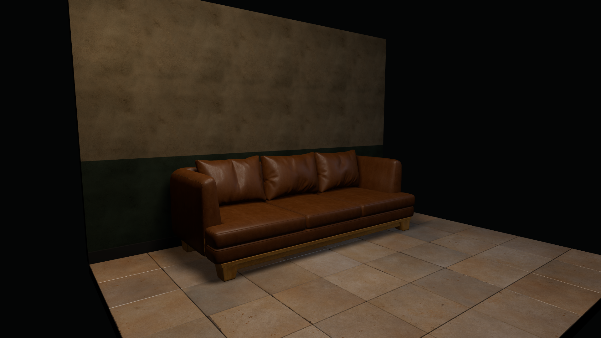

# 沙发、后墙与地砖：Godot 质感小样

这是独立的材质验证场景，未替换游戏主场景。2026-10-19，Godot 4.6 Forward+ / Vulkan，RTX 5070 Ti Laptop GPU 实际运行截图，1920×1080。没有使用离线效果图。

## 同条件对比

两边使用相同相机、曝光、三盏灯、环境光、反射探针和源模型。为了直接观察扶手和坐垫，两边都隐藏了原毯子。黑色区域是小样布景之外。

| 观察区域 | 修改前 | 修改后 |
|---|---|---|
| 整体 | [原材质](previews/before_00_区域.png) | [新材质](previews/after_00_区域.png) |
| 皮革与褶皱 | [原材质](previews/before_01_皮革.png) | [新材质](previews/after_01_皮革.png) |
| 灰泥 | [原材质](previews/before_02_灰泥.png) | [新材质](previews/after_02_灰泥.png) |
| 地砖 | [原材质](previews/before_03_地砖.png) | [新材质](previews/after_03_地砖.png) |



## 检查与修改

- 原沙发已有真实靠垫褶皱、圆角与坐垫包边，继续使用；原皮革微细节弱，高光呈大片白亮。更换为实拍皮革的颜色、OpenGL 法线与粗糙度贴图；保持非金属，按约 0.4 米扫描尺寸映射。补充 662 个沿实际坐垫表面投射的双排针脚，投射只查询真实坐垫网格，避开原包围盒碰撞。
- 原墙面在去除斑点后过平。使用细灰泥扫描的三张 PBR 贴图，按约一米尺寸映射；墙裙独立调色。
- 保留 48 块有厚度和倒角的原地砖。扫描贴图每块取一个砖面，并裁去照片里的砖缝，避免与模型缝重叠。地面反光来自粗糙度贴图与实时反射，不使用发光。
- 使用固定柔光、微弱侧向光与补光看清表面和接触阴影。前后没有通过改变曝光或调暗灯光制造改善。

## 实际改善与剩余差距

皮革颗粒和褶皱的高光变化更清晰，原来大片塑料般的白亮反射受到控制；墙面具有灰泥孔隙，砖面有细颗粒、磨损和局部粗糙度差异。

这还没有达到参考图的完成度：皮革偏新、偏棕，缺少沿扶手和坐垫受力位置的定向磨损；灰泥仍有较均匀的斑驳，缺少参考图那种细腻、局部积灰与渗污；地砖反光仍偏均匀，砖缝边缘有少量生硬的亮线。局部场景不能证明整屋光影已经匹配参考图。

原靠垫约 129 万顶点，本轮未减面；小样验证材质方向，不代表游戏性能验收。没有做新的灯光烘焙，也未扩展其他资产。用户已于 2026-10-19 确认当前效果可以接受，本轮停止美术迭代并交付。整屋应用属于后续范围，尚未执行。

## 素材与复现

九张 2K 贴图来自 Poly Haven，作者 Rob Tuytel，CC0：

- [Brown Leather](https://polyhaven.com/a/brown_leather)
- [White Plaster 02](https://polyhaven.com/a/white_plaster_02)
- [Floor Tiles 08](https://polyhaven.com/a/floor_tiles_08)

具体下载地址和 SHA256 在 [sources.json](sources.json)。未选用的重度剥落地砖和花纹过强的墙面素材已从小样移除。

在项目的 Godot 4.6 编辑器中打开 `samples/material_study/after.tscn`，运行当前场景即可看见实时区域小样；`before.tscn` 保留原材质对照。

```powershell
Godot --path godot --script res://tools/material_study.gd
Godot --headless --path godot --script res://tools/verify_material_study.gd
```

第一条重新生成两份场景并采集四组原始截图；第二条验证比较条件、几何保留、材质输入、缝线和截图完整性。工具位于 `godot/tools/`，主房间、玩法脚本和原 Blender 工程未改动。运行结束有 7 个 Texture RID 的退出警告，截图成功生成；这不是视觉质量达标的证明。
